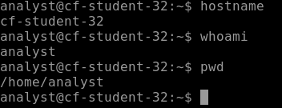

# Week 6 Lab 01 — Claiming Your Room in Cloud Heights

**Student Name:** Selerya Ward

**Date Completed:** 11/7/26

**Module:** 2 — Networking & Cloud Foundations | **Week:** 6  
**Submission Path:** `week-06/labs/lab-01-claiming-your-room.md`

---

> ### 🔒 Cloud Heights Security Rule
> Your Bastion link and Cloud Heights password are **private access credentials**. Never paste either into a worksheet, screenshot, GitHub repository, Circle post, or chat message. When taking screenshots, crop out the browser address bar and all login information.

---

## Overview

Week 5 was practice. This week the machine is real. Cloud Heights is a live Ubuntu 22.04 server running in Azure, and one of its rooms has **already been reserved for you** — you do not create it, provision it, or pay for it. Your job in this lab is to walk in the front door, prove you are standing inside your own room, and understand where that room came from.

This is a **guided** lab. Every step tells you what to do and what to record. Expect 30–40 minutes.

---

## Lab Environment / Pre-Lab Check

| Component | Details |
|---|---|
| Environment | Cloud Heights — live Ubuntu 22.04 VM in Azure, reached through Azure Bastion in your browser |
| Access | Lab Portal → **My Lab Environment** → your Cloud Heights card |
| Username | `analyst` |
| Password | Provided to you separately. Never typed into this worksheet. |
| Commands used | `hostname`, `whoami`, `pwd` |
| Auto-shutdown | Your VM stops automatically after 15 minutes of inactivity. A warning with **Keep Working** appears first. |

**Before you start:** open **My Lab Environment** in the Portal. If your VM shows **Stopped**, click **Start VM** and wait until the status reads **Running** — this takes a minute or two. Only then click **Open Cloud Heights**.

---

## Part A — Walking In

### Step 1 — Start the Room

In **My Lab Environment**, check your Cloud Heights status. Start the VM if it is stopped and wait for **Running**.

The status you saw before you started, and the status you saw after:

```
before: Stopped
after: Running
```

### Step 2 — Open Cloud Heights and Sign In

Click **Open Cloud Heights**. A browser-based session opens through Azure Bastion. Sign in with username `analyst` and the password you were given separately.

**Do not record the password, the link, or any part of the login screen anywhere.**

Describe what you saw once the session opened — what kind of screen greeted you:

```
A screen with a login window. The difference is that the protocol and port details were given, since we've learned what those details mean. The user name and password field are expected fields when logging into a machine or website.
```

### Step 3 — Ask the Machine Its Name

Run:
```
hostname
```
Output:

```
cf-student-32
```

### Step 4 — Ask Who You Are

Run:
```
whoami
```
Output:

```
analyst
```

### Step 5 — Ask Where You Are Standing

Run:
```
pwd
```
Output:

```
/home/analyst
```

---

## Part B — What Those Three Answers Prove

### Step 1 — Read Them as Evidence

Each of those three commands answered a different question: *which machine*, *which identity*, *which location in the filesystem*. Together they are the proof that you are inside your own room and not somebody else's.

Explain, in your own words, what each output proves:

```
The hostname command shows the machine that I'm currently connected to; I'm connected to the machine that was provided to me and must not be shared under any circumstances. The whoami command shows to credentials used to connect to my machine. The pwd command shows the current file path on the connected machine. Together, these commands answer the basic who, what, and where for this machine.
```

### Step 2 — Capture Your Evidence

Take a screenshot of your terminal showing the three commands and their outputs.

**Required filename:** `bastion-session.png`

**Crop rules — not optional.** The screenshot must show the terminal and prompt. It must **not** show the browser address bar, the Bastion link, any login screen, or any password field. Crop before you upload.

Upload it to `assets/screenshots/week-06/` in your portfolio repository, then paste its link here:



---

## Part C — Where Your Room Came From

### Step 1 — The Golden Image Idea

Every student's Cloud Heights room was built from the **same standardized image** — a known-good snapshot of a configured Ubuntu machine. Nobody hand-built 20 servers. One machine was configured correctly once, captured, and stamped out repeatedly.

Explain in your own words what a standardized (golden) image is and why an organization would build one:

```
A golden image is an efficient use of time and resources. An organization would build one to save time spent repeatedly building and rebuilding the same machine for multiple staff members or situations. It is far more efficient to build a machine once and copy the framework when it needs to be applied in the future.
```

### Step 2 — Same Start, Different Rooms

Your room started identical to everyone else's, and from today it starts to diverge as you work in it.

Explain what stays the same across all the rooms and what becomes yours alone:

```
The machine image and initial file path starts the same. As time progresses, the files that are created and history of commands run becomes work that I've done on my own.
```

---

## Analysis Questions

**Analysis Question 1.** Why does it matter that a standardized image can be *restored*, not just deployed? Describe a realistic situation where restoring from a known-good image is the fastest safe fix. *(Minimum 3 sentences.)*

```
It matters that a standardized image can be restored since it takes minutes to restore, rather than days to build and deploy and replacement. A situation where restoring a known-good image is if an update goes badly. If an update causes some type of failure, then a machine can be restored to a last known good configuration while the update is corrected. This ensures that an outage is kept as minimal as possible.
```

**Analysis Question 2.** Conceptually, how is a snapshot different from a separate backup? Consider what each one protects against and where each one lives. *(Minimum 3 sentences.)*

```
A snapshot is different from a backup in that a snapshot is a copy of a disk that is stored on the same disk. A backup is a separately-protected copy stored in a different location. A backup protects against a storage failure on the machine. If the storage on a machine fails, the snapshot is lost; a backup is protected since it's stored on separate storage hardware.
```

**Analysis Question 3.** Your room was reserved for you rather than created by you. What does that tell you about how cloud access is usually handed out in a real organization, and why would an employer prefer that model? *(Minimum 2 sentences.)*

```
A room was reserved rather than created in order to protect least privilege. Access is only granted to those that need it to do the job. An employer would prefer that model since it is the most secure. Rather than hoping someone doesn't do something improper with too much access, access is restricted to prevent mistakes from being made.
```

---

## Submission Checklist

- [x] VM started from My Lab Environment and confirmed **Running** (Part A, Step 1)

- [x] Signed in through Bastion as `analyst` — no credentials recorded anywhere (Part A, Step 2)

- [x] `hostname`, `whoami`, and `pwd` run and outputs recorded (Part A, Steps 3–5)

- [x] Explained what each of the three outputs proves (Part B, Step 1)

- [x] `bastion-session.png` captured, address bar and login data cropped out, uploaded to `assets/screenshots/week-06/` (Part B, Step 2)

- [x] Standardized/golden image explained in your own words (Part C)

- [x] All three Analysis Questions answered (minimum sentence counts met)

- [x] This file is committed to your portfolio repo at `week-06/labs/lab-01-claiming-your-room.md`

---

## GitHub Commit Subsection

1. Open **Week 6 → Lab 01: Claiming Your Room in Cloud Heights** in the Lab Portal.
2. Fill in the worksheet fields — they match this file, in the same order.
3. Connect your GitHub account if you haven't already, and select your portfolio repo.
4. Click **Submit to GitHub**. The Portal commits the completed file to `week-06/labs/lab-01-claiming-your-room.md`.
5. Upload `bastion-session.png` to `assets/screenshots/week-06/` in your repo before you submit.

---

*CyberVisionaries Institute · Cyber Foundations · Tier I*
