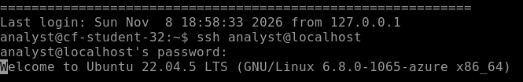

# Week 6 Lab 02 — Knocking on Door 22

**Student Name:** Selerya Ward

**Date Completed:** 11/8/26

**Module:** 2 — Networking & Cloud Foundations | **Week:** 6  
**Submission Path:** `week-06/labs/lab-02-knocking-on-door-22.md`

---

> ### 🔒 Cloud Heights Security Rule
> Your Bastion link and Cloud Heights password are **private access credentials**. Never paste either into a worksheet, screenshot, GitHub repository, Circle post, or chat message. When taking screenshots, crop out the browser address bar and all login information.

---

## Overview

Week 5 told you SSH is how administrators reach a machine over the network, and that it knocks on **port 22**. This week you knock yourself. You are already inside Cloud Heights through Bastion — now you will open a second, nested SSH session from your machine *to itself* and watch every step of what SSH does before it lets you in.

Starts **guided**, finishes **independent**. Expect 30–40 minutes.

**This lab uses password authentication only.** SSH keys are Week 8. Do not go looking for them yet.

---

## Lab Environment / Pre-Lab Check

| Component | Details |
|---|---|
| Environment | Cloud Heights — live Ubuntu 22.04 VM, reached through Azure Bastion |
| Username | `analyst` |
| Password | Provided separately. Never typed into this worksheet. |
| Commands used | `ssh`, `whoami`, `hostname`, `pwd`, `exit` |
| Prerequisite | Week 6 Lab 01 completed |

**Before you start:** open **My Lab Environment**, start your VM if needed, wait for **Running**, then open Cloud Heights.

---

## Part A — Two Ways Into the Same Room

### Step 1 — Name the Path You Already Used

You reached Cloud Heights through a browser session. Something else handled the network hop for you.

Describe, in your own words, what the Bastion/browser path did on your behalf:

```
The Bastion / browser path resolved the DNS name and made the connection to the machine via port 22. The only step left for me to do is to get in the second door via authentication.
```

### Step 2 — Predict the Manual Path

You are about to type an SSH command by hand. Before you run it, write what you expect to happen and what you expect to be asked for:

```
When I type the command, I expect to be prompted for credentials to prove that I should be granted access through the door that I'm knocking at.
```

---

## Part B — Knocking

### Step 1 — Run the SSH Command

In your Cloud Heights terminal, run:
```
ssh analyst@localhost
```

After you press Enter, SSH may show one of two valid responses.

- If this SSH client has not recorded `localhost` before, you may receive a **first-connection host fingerprint prompt**.
- If `localhost` is already recorded as a known host, SSH may skip that prompt and take you **directly to password authentication**.

Both are valid. Continue with the instructions that match what you see.

### Step 2 — Observe the SSH Connection

The first time SSH connects to an unfamiliar host, it may display the host's **fingerprint** and ask whether you want to continue connecting.

If the host is already recorded in your SSH `known_hosts` file, SSH may skip this confirmation and proceed directly to authentication.

**Do not reset or delete SSH trust information just to make the first-connection prompt appear.**

**If you see the fingerprint prompt:** stop and read it, record it below, answer the question that follows, and then type `yes` when you are ready to continue. A fingerprint is **not** a credential — it is a public identifier of the machine, so it is safe to record.

**If you do not see the fingerprint prompt:** this is okay. It means SSH already recognises `localhost` as a known host in this environment. Write `Host already known — fingerprint prompt not displayed.` below and continue to Step 3. You lose no credit for this.

Record what SSH showed you — paste the first-connection prompt, or write `Host already known — fingerprint prompt not displayed.`:

```
The authenticity of host 'localhost (127.0.0.1)' can't be established.
...key fingerprint is SHA256...
This key is not known by any other names
Are you sure you want to continue connecting (yes/no/[fingerprint])?
```

Why does SSH verify a host's identity when connecting to an unfamiliar system? If you received the first-connection prompt, also explain why it was reasonable to continue in this controlled Cloud Heights lab environment:

```
The identity is verified first before approving initial access. This is expected behavior to be learned going forward. It's reasonable to continue in this lab environment because I know that I have approved access to this system via the machine link I was given. 
```

### Step 3 — Enter Your Password

> ### ⚠️ PASSWORD INPUT WILL BE INVISIBLE
> When SSH asks for the `analyst` password, type or paste the password and press Enter.
>
> Linux does not display password input.
>
> You will **NOT** see:
> - letters or numbers
> - dots
> - asterisks
> - the cursor moving as characters are entered
>
> This is normal.
>
> The terminal may look like nothing is happening even though it is accepting the password.
>
> Enter the password once, press Enter once, and wait for SSH to respond.
>
> If clipboard paste does not work in your browser/Bastion terminal, type the password manually.

If you saw the fingerprint prompt, type `yes` first. Then enter your password at the password prompt.

**Troubleshooting.** If you get `Permission denied`, do not repeatedly retry credentials — capture the error and contact your instructor or post in the Lab Troubleshooting space. If you enter the password, press Enter, wait several seconds, and get neither a new prompt nor an error, capture the entire terminal state for troubleshooting. Do not restart the whole lab on your own.

What did the screen show while you typed:

```
nothing was displayed, as previously explained in the course lesson
```

### Step 4 — Prove You Are in the Nested Session

Inside the new session run each of these and record the output:
```
whoami
```

```
analyst
```

```
hostname
```

```
cf-student-32
```

```
pwd
```

```
/host/analyst
```

### Step 5 — Notice the Prompt

Compare the prompt now to the prompt before you ran `ssh`. Describe anything that changed and anything that looks identical, and explain why it looks that way given where you connected to:

```
There was no change to the screen. This was expected since I opened a nested session from my machine to itself. 
```

### Step 6 — Capture Your Evidence

Screenshot your terminal showing the SSH connection activity. **Either** valid state is accepted:

- **State A** — a screenshot showing the SSH **first-connection / fingerprint prompt** (and the successful session), **or**
- **State B** — a screenshot showing the SSH **authentication / successful login** state when `localhost` was already a known host.

Your screenshot must show that you performed the SSH connection. You are not penalised if the fingerprint prompt was never generated.

**Required filename:** `ssh-first-connection.png` (filename kept for submission compatibility — its contents may show either state)

**Crop rules.** No Bastion URL, no address bar, no password field, no login screen. The fingerprint text, if present, is fine.



### Step 7 — Leave

Run:
```
exit
```
What did the prompt look like after exiting, and how do you know you are back in the original session:

```
I know that I'm back in the original session since the screen text displayed, "logout Connection to localhost closed."
```

---

## Part C — The Deliberate Failure (Independent)

### Step 1 — Knock With the Wrong Name

Run an SSH command to `localhost` using a username that does not exist on this machine — for example `ssh notauser@localhost`. Enter anything at the password prompt.

Command you ran:

```
ssh scwardsc@localhost
```

Output:

```
ssh scwardsc@localhost
scwardsc@localhost's password:
Permission denied, please try again.
scwardsc@localhost's password:
```

### Step 2 — Read the Failure Correctly

`Permission denied` is a **failure of authentication**, not a failure of the network.

Explain what the network and SSH already had to do successfully in order for you to be told "permission denied" at all:

```
First, the network had to establish an initial connection to the machine. Second, SSH had to determine if the given username and provided password matched to be allowed access. Since the given user name and password didn't match what was stored in the database, the 'permission denied' message was received. 
```

---

## Analysis Questions

**Analysis Question 1.** Distinguish *reach* from *authentication*. Which one had already succeeded when you saw a password prompt, and how do you know? *(Minimum 3 sentences.)*

```
Reach has already succeeded if a password prompt is received. Reach is one of the first steps in a remote connection. A network name has to be resolved to an IP address, and an initial connection is established. If an error is received instead of a password prompt, it means that there is an issue before authentication can be started.
```

**Analysis Question 2.** SSH records a host's identity so it can warn you if that identity ever changes. Describe a situation where accepting a host fingerprint without thinking — or ignoring a changed-host warning — would be a real problem. *(Minimum 3 sentences.)*

```
Accepting a host fingerprint without thinking could cause a security issue if the fingerprint is forged somehow. The same scenario could happen if a changed-host warning is ignored. It is a good reminder that a lot of preventable security breaches have happened due to human error. This is the potential outcome if a host fingerprint is accepted by reflex instead of by confirmation.
```

**Analysis Question 3.** What changed and what stayed the same when you moved from the outer session into the nested SSH session, and why? *(Minimum 2 sentences.)*

```
The port changed when I moved from the outer session into the nested session since I specified to establish a connection using SSH (port 22). Running the hostname, whoami, and pwd commands returned the same answers. These stayed the same since I made a nested connection from my virtual machine into the same machine.
```

**Analysis Question 4.** A colleague says "SSH is broken, I got permission denied." Using only what you learned in this lab, what would you tell them is already working, and what would you check next? *(Minimum 3 sentences.)*

```
I would tell the colleague that it may not be SSH that's broken if the displayed message is 'permission denied'. I would ask them to tell me the user name prompt on their screen; it's possible that there was a mistake in typing it. I might also ask them to check if their Caps Lock is turned on; this is a common way to get a permission denied message.
```

---

## Submission Checklist

- [x] Bastion path vs. manual SSH path described (Part A)

- [x] `ssh analyst@localhost` run and the SSH response recorded — fingerprint prompt **or** "host already known" (Part B, Steps 1–2)

- [x] Password entered; non-echoing input observed and described (Part B, Step 3)

- [x] `whoami`, `hostname`, `pwd` run inside the nested session (Part B, Step 4)

- [x] Prompt change described (Part B, Step 5)

- [x] `ssh-first-connection.png` captured (fingerprint prompt **or** authentication/login state), cropped, uploaded to `assets/screenshots/week-06/` (Part B, Step 6)

- [x] Session exited cleanly (Part B, Step 7)

- [x] Bad-username test run and `Permission denied` output recorded (Part C)

- [x] All four Analysis Questions answered (minimum sentence counts met)

- [x] This file is committed to your portfolio repo at `week-06/labs/lab-02-knocking-on-door-22.md`

---

## GitHub Commit Subsection

1. Open **Week 6 → Lab 02: Knocking on Door 22** in the Lab Portal.
2. Fill in the worksheet fields and upload `ssh-first-connection.png` to `assets/screenshots/week-06/`.
3. Click **Submit to GitHub** — the Portal commits to `week-06/labs/lab-02-knocking-on-door-22.md`.

---

*CyberVisionaries Institute · Cyber Foundations · Tier I*
