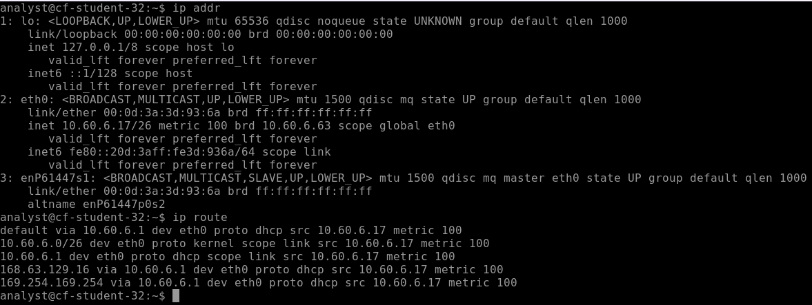
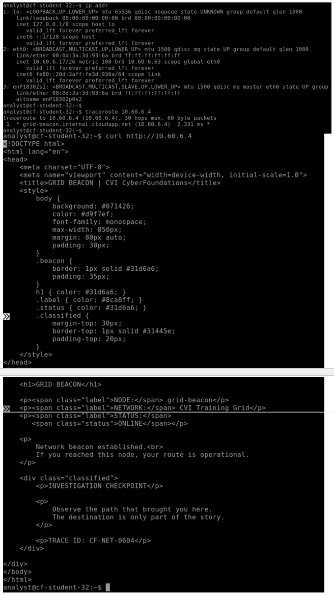

# Week 6 Lab 03 — The Grid, For Real

**Student Name:** Selerya Ward

**Date Completed:** 11/11/26

**Module:** 2 — Networking & Cloud Foundations | **Week:** 6  
**Submission Path:** `week-06/labs/lab-03-the-grid-for-real.md`

---

> ### 🔒 Cloud Heights Security Rule
> Your Bastion link and Cloud Heights password are **private access credentials**. Never paste either into a worksheet, screenshot, GitHub repository, Circle post, or chat message. When taking screenshots, crop out the browser address bar and all login information.

---

## Overview

In Week 5 you ran `ip addr`, `ip route`, `ping`, and `traceroute` in a simulator that always behaved. Today you run the same toolkit against real cloud infrastructure that does **not** always behave the way the textbook implies — and you learn to tell "broken" apart from "normal."

This is an **independent** lab. It tells you what to accomplish; you choose the commands. Expect about 40 minutes.

---

## Lab Environment / Pre-Lab Check

| Component | Details |
|---|---|
| Environment | Cloud Heights — live Ubuntu 22.04 VM, reached through Azure Bastion |
| Commands used | `ip addr`, `ip route`, `ping`, `traceroute`, `curl` |
| Known-good target | **Grid Beacon — `10.60.6.4`** |
| Prerequisite | Week 6 Labs 01–02 |

---

## Part A — Where You Actually Are

### Step 1 — Read Your Own Address

Run the command that lists your interfaces and addresses.

Command and output:

```
Command: ip addr

Output:
1: lo: <LOOPBACK,UP,LOWER_UP> mtu 65536 qdisc noqueue state UNKNOWN group default qlen 1000
    link/loopback 00:00:00:00:00:00 brd 00:00:00:00:00:00
    inet 127.0.0.1/8 scope host lo
       valid_lft forever preferred_lft forever
    inet6 ::1/128 scope host 
       valid_lft forever preferred_lft forever
2: eth0: <BROADCAST,MULTICAST,UP,LOWER_UP> mtu 1500 qdisc mq state UP group default qlen 1000
    link/ether 00:0d:3a:3d:93:6a brd ff:ff:ff:ff:ff:ff
    inet 10.60.6.17/26 metric 100 brd 10.60.6.63 scope global eth0
       valid_lft forever preferred_lft forever
    inet6 fe80::20d:3aff:fe3d:936a/64 scope link 
       valid_lft forever preferred_lft forever
3: enP35083s1: <BROADCAST,MULTICAST,SLAVE,UP,LOWER_UP> mtu 1500 qdisc mq master eth0 state UP group default qlen 1000
    link/ether 00:0d:3a:3d:93:6a brd ff:ff:ff:ff:ff:ff
    altname enP35083p0s2
```

Your private IPv4 address and prefix length:

```
10.60.6.17/26
```

### Step 2 — Read Your Route

Run the command that shows the routing table.

Command and output:

```
command:ip route

output:
default via 10.60.6.1 dev eth0 proto dhcp src 10.60.6.17 metric 100 
10.60.6.0/26 dev eth0 proto kernel scope link src 10.60.6.17 metric 100 
10.60.6.1 dev eth0 proto dhcp scope link src 10.60.6.17 metric 100 
168.63.129.16 via 10.60.6.1 dev eth0 proto dhcp src 10.60.6.17 metric 100 
169.254.169.254 via 10.60.6.1 dev eth0 proto dhcp src 10.60.6.17 metric 100
```

Your default gateway:

```
10.60.6.1
```

### Step 3 — Compare to Week 5

Compare this live Ubuntu output to what the CLI Simulator produced in Week 5. What looks the same, what looks different, and what surprised you:

```
Between the live output and the simulator, the lines for loopback and Ethernet connection looked very nearly the same. Like it was mentioned in the lesson, there were 4 neat lines returned in the simulator. On the live output, there were 6 lines that included inet6, which I had to look up and see that it was an IPv6 address. This was different, and I had to look at the Week 5 entry in a separate window to make sure I was sure of what I was looking at. The third entry for enP35083s1 surprised me. I'm guessing it's the connection to the virtual machine, but I know that I'll found out in a future lesson.
```

---

## Part B — The Gateway That Does Not Answer

### Step 1 — Ping the Gateway

Ping the default gateway address you recorded. Let it run a few seconds, then stop it.

Command and output:

```
command: ping 10.60.6.1

output:
PING 10.60.6.1 (10.60.6.1) 56(84) bytes of data.

--- 10.60.6.1 ping statistics ---
14 packets transmitted, 0 received, 100% packet loss, time 13314ms
```

### Step 2 — Interpret It Correctly

You almost certainly got **no replies**. In Azure, the platform gateway commonly does not answer ICMP. This is **expected platform behaviour** and by itself proves nothing about whether your machine or network is broken.

Explain why "the gateway did not answer ping" is weak evidence:

```
During the lesson, it was explained that 100% packet loss doesn't prove a site is down. It is a piece to a puzzle, and other pieces need to be put together in order to see the whole picture. In this instance, 100% packet loss shows that this kind of message does not come back from this particular address, by design. It is necessary to ask multiple questions in order to get to the correct conclusion instead of jumping to the first conclusion, since it may be wrong.
```

---

## Part C — The Known-Good Target

The **Grid Beacon** at `10.60.6.4` is a machine that is known to be up and known to answer. When your first probe fails, you test against something known-good before you conclude anything.

### Step 1 — Ping the Beacon

```
ping 10.60.6.4
```
Output:

```
analyst@cf-student-32:~$ ping 10.60.6.4
PING 10.60.6.4 (10.60.6.4) 56(84) bytes of data.
64 bytes from 10.60.6.4: icmp_seq=1 ttl=64 time=1.88 ms
64 bytes from 10.60.6.4: icmp_seq=2 ttl=64 time=1.13 ms
64 bytes from 10.60.6.4: icmp_seq=3 ttl=64 time=1.04 ms
64 bytes from 10.60.6.4: icmp_seq=4 ttl=64 time=1.09 ms
64 bytes from 10.60.6.4: icmp_seq=5 ttl=64 time=2.03 ms
64 bytes from 10.60.6.4: icmp_seq=6 ttl=64 time=1.13 ms
64 bytes from 10.60.6.4: icmp_seq=7 ttl=64 time=1.09 ms
64 bytes from 10.60.6.4: icmp_seq=8 ttl=64 time=1.41 ms

--- 10.60.6.4 ping statistics ---
8 packets transmitted, 8 received, 0% packet loss, time 7009ms
rtt min/avg/max/mdev = 1.042/1.350/2.032/0.367 ms
```

### Step 2 — Trace the Path

```
traceroute 10.60.6.4
```
Output:

```
analyst@cf-student-32:~$ traceroute 10.60.6.4

traceroute to 10.60.6.4 (10.60.6.4), 30 hops max, 60 byte packets
 1  grid-beacon.internal.cloudapp.net (10.60.6.4)  1.369 ms  1.325 ms *
```

### Step 3 — Ask the Application

```
curl http://10.60.6.4
```
Output:

```
analyst@cf-student-32:~$ curl http://10.60.6.4
<!DOCTYPE html>
<html lang="en">
<head>
    <meta charset="UTF-8">
	<meta name="viewport" content="width=device-width, initial-scale=1.0">
	<title> GRID BEACON | CVI CyberFoundations</title>
	<style>
	    body {
		   background: #071426;
		   color: #d9f7ef;
		   font-family: monospace;
           max-width: 850px;
           margin: 80px auto;
           padding: 30px;
        }
        .beacon {
            border: 1px solid #31d6a6;
            padding: 35px;
        }
        h1 { color: #31d6a6; }
        .label { color: #8ca8ff; }
        .status { color: #31d6a6; }
        .classified {
            margin-top: 30px;
            border-top: 1px solid #31445e;
            padding-top: 20px;
        }
    </style>
</head>
<body>
<div class="beacon">

    <h1>GRID BEACON</h1>

    <p><span class="label">NODE:</span> grid-beacon</p>
    <p><span class="label">NETWORK:</span> CVI Training Grid</p>
    <p><span class="label">STATUS:</span>
       <span class="status">ONLINE</span></p>

    <p>
        Network beacon established.<br>
        If you reached this node, your route is operational.
    </p>

    <div class="classified">
        <p>INVESTIGATION CHECKPOINT</p>

        <p>
            Observe the path that brought you here.
            The destination is only part of the story.
        </p>

        <p>TRACE ID: CF-NET-0604</p>
    </div>

</div>
</body>
</html>
```

> ### ⚠️ Grid Beacon not responding?
> The Grid Beacon is shared course infrastructure and should normally be available. First, confirm your Cloud Heights VM shows **Running** and that you completed the preceding network checks. Then retry the command once after a minute or two.
>
> If the Grid Beacon still does not respond, **stop this part of the lab and contact your instructor.** Record that the shared service was unavailable; do not treat the result as evidence that your VM or your work is incorrect.
>
> Do not change networking, NSGs, firewall rules, routes, DNS, or any Azure settings to try to reach the beacon.
>
> *Instructor note: a confirmed Grid Beacon outage is an environment issue, not a student error. Affected students may complete this portion of Lab 03 after the service is restored, with no penalty.*

### Step 4 — Record the Application Evidence

The beacon returns a banner and a trace ID. Record exactly what you received:

```
Network beacon established.
If you reached this node, your route is operational.

TRACE ID: CF-NET-0604
```

Explain the difference between what the `ping` proved and what the `curl` proved:

```
Ping proved that a particular machine acknowledged with an answer to this kind of question. Curl proved that the site is accessible outside of a browser. Both tools can be used to troubleshoot a network issue; they are both questions that can be used to rule out possible issues.
```

### Step 5 — Capture Your Evidence

Two screenshots, both cropped to the terminal only:

**Required filename:** `vm-toolkit-live.png` — your `ip addr` and `ip route` output



**Required filename:** `beacon-reply.png` — your beacon ping/traceroute/curl evidence



---

## Part D — Rewrite the Ladder Rule

Week 5 taught the Ladder Rule: test the near thing before the far thing. Real infrastructure adds a wrinkle — a silent rung is not automatically a broken rung.

Rewrite the Ladder Rule in your own words so that it survives real cloud infrastructure. Your version must include both **route/path evidence** and **a known-good target**:

```
Step 1 should be to check your own machine using ip addr. This determines that there is a valid IP address; it's found on the eth0 line. The next step now has 2 parts. Step 2a is to run ip route to determine the default gateway. Step 2b is to attempt to reach a known good target past the default gateway. In this week's lesson, we can use grid-beacon at 10.60.6.10 to prove this. Step 3, ping the host name, and the remaining steps remain the same. Step 4 is still to check the target by running a ping on the IP address, and step 5 is to run a traceroute to the host.
```

---

## Analysis Questions

**Analysis Question 1.** Your ping to the gateway failed and your ping to the beacon succeeded. What does that pair of results, taken together, prove about your machine's networking? *(Minimum 3 sentences.)*

```
The pair of results prove that the network still works. This is because some virtual machines are configured not to respond to ping. As a result, it's good practice to ping a known good target in order to prove that the networking of the single machine is operational.
```

**Analysis Question 2.** Why is `traceroute` useful even when `ping` already answered? What extra thing does it show you? *(Minimum 2 sentences.)*

```
Traceroute is helpful because it shows the default gateway. This is important to know since it may be necessary to prove internal traffic is moving as well as external traffic is moving. The default gateway is how traffic moves outside the internal network.
```

**Analysis Question 3.** A service is unreachable and ping to it succeeds. Where would you look next, and why is "the network is fine" an incomplete answer? *(Minimum 3 sentences.)*

```
The next item to check would be to see the results of dig to the particular address. If a hostname is revealed, then ping the hostname. Those 2 steps determine if the address is being resolved to the host name, and if there is a path to the machine.
```

**Analysis Question 4.** Something already controls what is allowed to reach your machine in Cloud Heights. If you could decide those rules, what would you want to allow, what would you want to block, and who in an organization should get to make that decision? *(Minimum 3 sentences.)*

```
Thinking in the area of least privilege, I would want to allow what is proven necessary to get the job done. Some examples of this would be email and secure web browsing. I've seen in other studies where a very secure network blocks every port that is not being used. I can imagine that someone that reports to the Chief Info Security Officer would make the decision on what is allowed and what is blocked.
```

---

## Submission Checklist

- [x] `ip addr` output recorded and own private IP/prefix identified (Part A)

- [x] `ip route` output recorded and default gateway identified (Part A)

- [x] Live output compared to the Week 5 simulator (Part A, Step 3)

- [x] Gateway pinged and the silent result interpreted correctly (Part B)

- [x] Beacon `ping`, `traceroute`, and `curl` all run and recorded (Part C)

- [x] Beacon banner and TRACE ID recorded (Part C, Step 4)

- [x] `vm-toolkit-live.png` and `beacon-reply.png` captured, cropped, uploaded to `assets/screenshots/week-06/` (Part C, Step 5)

- [x] Ladder Rule rewritten with route evidence + known-good target (Part D)

- [x] All four Analysis Questions answered (minimum sentence counts met)

- [x] This file is committed to your portfolio repo at `week-06/labs/lab-03-the-grid-for-real.md`

---

## GitHub Commit Subsection

1. Open **Week 6 → Lab 03: The Grid, For Real** in the Lab Portal.
2. Fill in the worksheet fields and upload both screenshots to `assets/screenshots/week-06/`.
3. Click **Submit to GitHub** — the Portal commits to `week-06/labs/lab-03-the-grid-for-real.md`.

---

*CyberVisionaries Institute · Cyber Foundations · Tier I*
