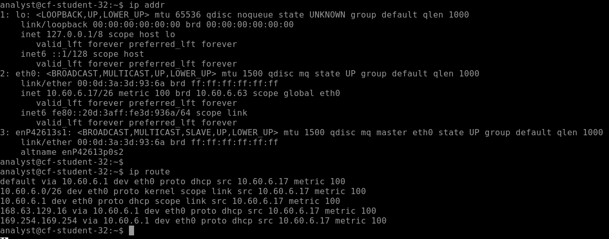

# Week 6 Lab 04 — Reading the Blueprints

**Student Name:** Selerya Ward

**Date Completed:** 11/15/26

**Module:** 2 — Networking & Cloud Foundations | **Week:** 6  
**Submission Path:** `week-06/labs/lab-04-reading-the-blueprints.md`

---

> ### 🔒 Cloud Heights Security Rule
> Your Bastion link and Cloud Heights password are **private access credentials**. Never paste either into a worksheet, screenshot, GitHub repository, Circle post, or chat message. When taking screenshots, crop out the browser address bar and all login information.

---

## Overview

**This is a SHORT lab — 15 to 20 minutes.** It is deliberately small. You already have the commands; this lab is about matching a drawing to reality.

The **Cloud Heights Network Blueprint** is displayed at the top of this lab page in the portal. Everything you write about the network's architecture comes from that blueprint or from your own machine — never from a guess.

---

## Lab Environment / Pre-Lab Check

| Component | Details |
|---|---|
| Environment | Cloud Heights — live Ubuntu 22.04 VM, reached through Azure Bastion |
| Source of truth | The Cloud Heights Network Blueprint shown at the top of this lab page |
| Commands used | `ip addr`, `ip route` |
| Known value | Student subnet: **`10.60.6.0/26`** |

---

## Part A — Read the Drawing

### Step 1 — Record the Architecture Values

From the blueprint at the top of this page, record each value **exactly as drawn**. If a value is not shown on the blueprint, write "not shown on blueprint" — do not guess.

| Item | Value from the blueprint |
| --- | --- |
| VNet name | vnet-cf-labs |
| VNet address space | 10.60.6.0/24 |
| Student subnet range | 10.60.6.0/26 |

---

## Part B — Verify Against Your Own Machine

### Step 1 — Confirm Your Address Lives in the Subnet

Run `ip addr` and find your private IPv4 address.

Command and output:

```
command: ip addr

output:
1: lo: <LOOPBACK,UP,LOWER_UP> mtu 65536 qdisc noqueue state UNKNOWN group default qlen 1000
    link/loopback 00:00:00:00:00:00 brd 00:00:00:00:00:00
    inet 127.0.0.1/8 scope host lo
       valid_lft forever preferred_lft forever
    inet6 ::1/128 scope host 
       valid_lft forever preferred_lft forever
2: eth0: <BROADCAST,MULTICAST,UP,LOWER_UP> mtu 1500 qdisc mq state UP group default qlen 1000
    link/ether 00:0d:3a:3d:93:6a brd ff:ff:ff:ff:ff:ff
    inet 10.60.6.17/26 metric 100 brd 10.60.6.63 scope global eth0
       valid_lft forever preferred_lft forever
    inet6 fe80::20d:3aff:fe3d:936a/64 scope link 
       valid_lft forever preferred_lft forever
3: enP42613s1: <BROADCAST,MULTICAST,SLAVE,UP,LOWER_UP> mtu 1500 qdisc mq master eth0 state UP group default qlen 1000
    link/ether 00:0d:3a:3d:93:6a brd ff:ff:ff:ff:ff:ff
    altname enP42613p0s2
```

Your private IP:

```
10.60.6.17/26
```

Explain how you know your address falls inside `10.60.6.0/26` — what range does that prefix actually cover:

```
I know that my address falls inside 10.60.6.0/26 because it is within the network block from 10.60.6.1 to 10.60.6.254. The range covers addresses between 10.60.6.1, with 10.60.6.1 being the default gateway, all the way to 10.60.6.254.
```

### Step 2 — Confirm Route Behaviour

Run `ip route`.

Command and output:

```
analyst@cf-student-32:~$ ip route

default via 10.60.6.1 dev eth0 proto dhcp src 10.60.6.17 metric 100 
10.60.6.0/26 dev eth0 proto kernel scope link src 10.60.6.17 metric 100 
10.60.6.1 dev eth0 proto dhcp scope link src 10.60.6.17 metric 100 
168.63.129.16 via 10.60.6.1 dev eth0 proto dhcp src 10.60.6.17 metric 100 
169.254.169.254 via 10.60.6.1 dev eth0 proto dhcp src 10.60.6.17 metric 100 
```

What the default route tells you about traffic that is not destined for your own subnet:

```
The default route lets me know that traffic outside my own subnet travels first to the default gateway of 10.60.6.1. It then travels to the open internet via 168.63.129.16.
```

### Step 3 — Capture Your Evidence

**Required filename:** `blueprint-verified.png`

This must be **your own `ip addr` and `ip route` output** — not a re-screenshot of the blueprint. Crop out the address bar and any login information.



---

## Part C — How Traffic Actually Moves

### Step 1 — No Public IP

Your VM has a private address and **no public IP**. Explain what that means for who can reach it directly from the internet:

```
No public IP means that my VM cannot be accessed directly from the Internet, and this is by design. It only has a private address that can be accessed via the default gateway, which determines what traffic is allowed in or out. This is a security feature rather than a limitation that is used to keep the network secure, by limiting accessibility.
```

### Step 2 — Outbound vs. Inbound

Outbound internet traffic from your VM leaves through address **translation (NAT)**. Inbound access for you arrives through **Azure Bastion**, not through a public address on the VM.

Explain both directions in your own words:

```
Outgoing traffic reaches the default gateway, where it is then translated to a public address and routed to the final destination. Inbound traffic is routed to the Azure Bastion VM, which is segmented on a private network with other students' VMs.
```

### Step 3 — The Guard Post You Do Not Touch Yet

Each student machine sits behind its own **network security group** — a per-student guard post that decides what traffic is allowed in.

**In Week 6 you do not configure it.** Week 7 is when you take control of those rules.

Write one sentence naming what the guard post does and one sentence stating what you are *not* doing with it this week:

```
The guard post limits traffic from the public Internet to the internal network. This week, we are not making changes to limit inbound traffic.
```

---

## Analysis Questions

**Analysis Question 1.** Why would an organization put every student machine in one small subnet instead of giving each machine a public address? *(Minimum 3 sentences.)*

```
It is more secure to have all student machines in a small subnet rather than give each a public address in order to keep the learning environment secure. An environment where users are still learning can become a security risk if a mistake were made that left all devices and data at risk. Keeping specific devices separate in their own area also limits how far an issue can spread should a boundary get breached.
```

**Analysis Question 2.** Segmentation means separating a network into parts that cannot freely reach each other. Give one concrete benefit of segmentation during a security incident. *(Minimum 3 sentences.)*

```
In a security incident, it is far easier to limit the breach in a segmented network rather than have all devices at risk of breach. If there are 200 devices in a subnet that has been affected, it is far easier to investigate 200 devices instead of 1500 or more. Even after a security incident has been resolved, investigating the breach in order to understand the cause and prevent future occurrences is easier in fewer devices.
```

**Analysis Question 3.** A diagram and a live machine disagree about an address range. Which do you trust, what do you do next, and why? *(Minimum 2 sentences.)*

```
I will trust the live machine, since that is the source of truth. The diagram is the intended setup, but the diagram is verified by the machine. The next step would be to investigate additional machines in order to determine the cause of the mismatch between the live machine and the diagram.
```

---

## Submission Checklist

- [x] VNet name, address space, and subnet range recorded from the blueprint (Part A)

- [x] `ip addr` run and own private IP confirmed inside `10.60.6.0/26` (Part B, Step 1)

- [x] `ip route` run and default route behaviour explained (Part B, Step 2)

- [x] `blueprint-verified.png` captured from your own terminal, cropped, uploaded to `assets/screenshots/week-06/` (Part B, Step 3)

- [x] Private address / NAT / Bastion explained (Part C, Steps 1–2)

- [x] Per-student guard post identified — and explicitly not configured this week (Part C, Step 3)

- [x] All three Analysis Questions answered (minimum sentence counts met)

- [x] This file is committed to your portfolio repo at `week-06/labs/lab-04-reading-the-blueprints.md`

---

## GitHub Commit Subsection

1. Open **Week 6 → Lab 04: Reading the Blueprints** in the Lab Portal.
2. Fill in the worksheet fields and upload `blueprint-verified.png` to `assets/screenshots/week-06/`.
3. Click **Submit to GitHub** — the Portal commits to `week-06/labs/lab-04-reading-the-blueprints.md`.

---

*CyberVisionaries Institute · Cyber Foundations · Tier I*
